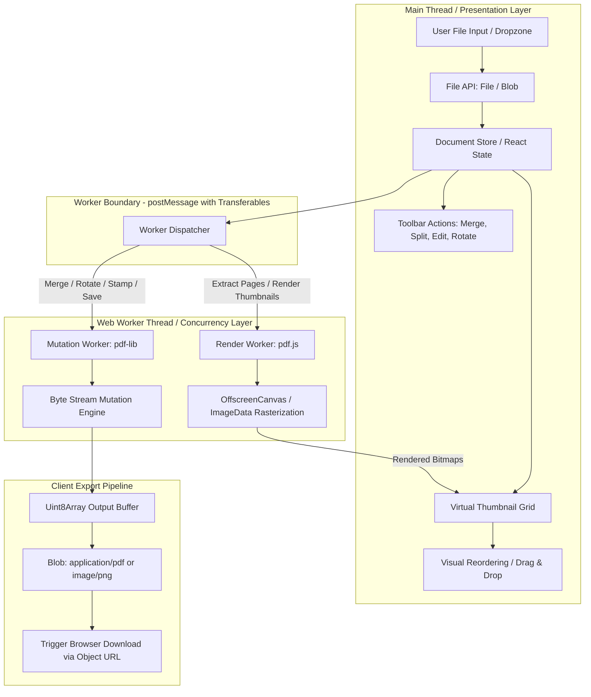
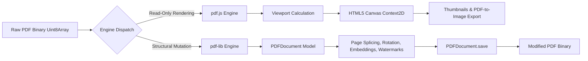
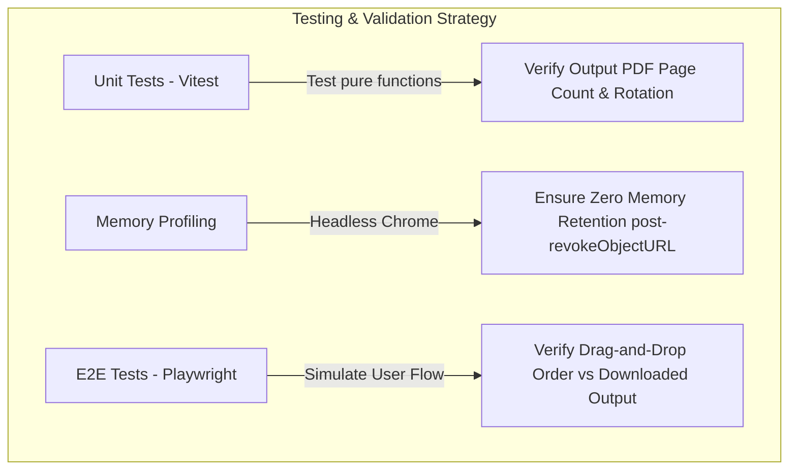

# PDF Toolkit — Privacy-First, Client-Side PDF Engineering Platform

> A production-grade, zero-server PDF manipulation and editing web application running 100% in the browser. User documents never leave their local device, guaranteeing zero latency from network uploads, zero cloud infrastructure cost, and compliance with data privacy regulations (GDPR, HIPAA, and SOC2).

---

## 1. Executive Summary & Core Philosophy

Traditional web-based PDF utilities (such as Smallpdf or ILovePDF) require users to upload sensitive documents to remote cloud servers for processing. This presents significant data security liabilities, compliance risks, bandwidth bottlenecks, and operational cloud costs.

**PDF Toolkit** rearchitects this paradigm by treating the modern web browser as a high-performance local execution runtime. Leveraging **WebAssembly**, **HTML5 Canvas**, **Web Workers**, and modern JavaScript PDF binaries (`pdf-lib` and `pdfjs-dist`), every document operation—from simple page rotation to complex cryptographic signature stamping and multi-file merging—is executed strictly within client memory.

### Key Tenets
1. **Absolute Privacy**: Zero telemetry on document content; no files or byte streams are sent over the network.
2. **Zero Cloud Infrastructure**: The entire app can be deployed to a static CDN (Cloudflare Pages, GitHub Pages, Vercel) with zero backend servers.
3. **Non-Blocking UI**: Compute-heavy operations (canvas rasterization, PDF serialization) run inside decoupled Web Workers using `Transferable` ArrayBuffers.
4. **Resilient Memory Management**: Strict lifecycle disposal of rendered canvases, virtualized thumbnail grids, and explicit `URL.revokeObjectURL()` calls prevent browser tab crashes on multi-hundred-page documents.

---

## 2. Technology Stack

| Layer | Technologies | Rationale |
| :--- | :--- | :--- |
| **Framework & Language** | **React 18 / 19**, **TypeScript** | Strict type safety for complex binary buffers, declarative UI component model. |
| **Bundler & Build Tool** | **Vite** | Fast HMR, native ES module support, out-of-the-box Web Worker instantiation via `?worker` / `new Worker()`. |
| **Styling & Design System** | **Tailwind CSS**, **Lucide React** | Utility-first, lightweight CSS footprint, cohesive UI iconography. |
| **PDF Manipulation Engine** | **`pdf-lib`** | Pure JavaScript PDF reader, writer, and mutator. Modifies raw PDF byte structures without native binaries. |
| **PDF Rendering Engine** | **`pdf.js` (`pdfjs-dist`)** | Mozilla's battle-tested PDF engine. Translates PDF bytecode into HTML5 `<canvas>` rendering commands. |
| **Drag & Drop Interactions** | **`@dnd-kit/core`**, **`@dnd-kit/sortable`** | High-performance, accessible touch- and mouse-friendly visual reordering. |
| **Concurrency & Workers** | **Web Workers API**, **Comlink** (optional) | Multi-threaded execution off the main browser thread. |
| **Archive Packaging** | **`JSZip`**, **`FileSaver.js`** | Client-side compression for bulk exports (e.g., PDF $\rightarrow$ ZIP of high-res images). |
| **Quality & Testing** | **Vitest / Jest**, **React Testing Library** | Unit testing pure PDF byte operations and UI component workflows. |

---

## 3. High-Level System Architecture

The application strictly separates **Presentation (React UI)**, **Rendering (`pdf.js`)**, and **Manipulation (`pdf-lib`)** into isolated layers communicating via typed message passing.



---

## 4. Dual-Engine PDF Pipeline Design

A key architectural pattern of this system is the deliberate bifurcation between **Rendering** and **Mutation**:



### 1. The Rendering Engine (`pdf.js`)
* **Role**: Visual inspection, thumbnail strip generation, full-page preview, and raster image extraction.
* **Mechanism**:
  1. Accepts an `ArrayBuffer` and initializes a `PDFDocumentProxy`.
  2. Iterates over requested page indices.
  3. Computes the viewport based on target scale and container dimensions.
  4. Paints text, paths, and raster assets onto an HTML5 `<canvas>`.
* **Constraint**: `pdf.js` is strictly a *view/render* engine; it cannot save or serialize modified PDF documents.

### 2. The Manipulation Engine (`pdf-lib`)
* **Role**: Structural page mutations, metadata updates, and binary serialization.
* **Mechanism**:
  1. Ingests bytes via `await PDFDocument.load(bytes)`.
  2. Creates new documents via `await PDFDocument.create()`.
  3. Uses low-level dictionary manipulations to copy pages between documents (`copyPages`), modify page rotation flags, inject fonts (`StandardFonts.Helvetica`), or embed external images (`embedPng`, `embedJpg`).
  4. Serializes the final state into a standard `Uint8Array` via `pdfDoc.save()`.

---

## 5. Web Worker Architecture & Concurrency Model

Running PDF rendering and byte serialization on the main thread causes dropped animation frames, UI freezing, and unresponsive browser alerts on documents larger than 5 MB.

### Concurrency Topology

```mermaid
sequenceDiagram
    autonumber
    actor User
    participant Main as React Main Thread
    participant Worker as PDF Processing Worker
    participant Engine as pdf-lib / pdf.js

    User->>Main: Uploads 50-page PDF (25MB)
    Main->>Main: Read File as ArrayBuffer
    Main->>Worker: postMessage({ type: 'LOAD_DOC', buffer }, [buffer]) (Transferable)
    Note over Main: Zero memory copy; buffer ownership transferred to Worker
    Worker->>Engine: Parse PDF Structure
    Engine-->>Worker: Structure Ready
    Worker-->>Main: postMessage({ type: 'DOC_LOADED', pageCount: 50 })
    
    loop On-Demand Virtual Scroll
        Main->>Worker: postMessage({ type: 'RENDER_PAGE', pageIndex: i, scale: 0.5 })
        Worker->>Engine: Render to OffscreenCanvas
        Worker-->>Main: Transfer ImageBitmap or PNG Data
        Main->>Main: Display Thumbnail
    end

    User->>Main: Click "Merge & Save"
    Main->>Worker: postMessage({ type: 'EXECUTE_MUTATION', plan: [...] })
    Worker->>Engine: Run pdf-lib pipeline
    Engine-->>Worker: Serialized Uint8Array
    Worker-->>Main: postMessage({ type: 'MUTATION_COMPLETE', resultBuffer }, [resultBuffer])
    Main->>User: Trigger Download Blob
```

### Memory Management Best Practices
1. **Transferable Objects**:
   When dispatching binary buffers between threads, always transfer ownership rather than cloning:
   ```ts
   // Main Thread -> Worker
   worker.postMessage({ type: 'PROCESS_PDF', buffer }, [buffer]);
   ```
2. **Object URL Hygiene**:
   Avoid holding references to generated Blob URLs in memory:
   ```ts
   const url = URL.createObjectURL(blob);
   const a = document.createElement('a');
   a.href = url;
   a.download = filename;
   a.click();
   // Immediately queue revocation to release heap allocation
   setTimeout(() => URL.revokeObjectURL(url), 1000);
   ```
3. **Canvas Element Recycling**:
   In virtualized thumbnail grids, explicitly clear canvas dimensions when unmounted to prompt browser garbage collection of GPU textures:
   ```ts
   canvas.width = 0;
   canvas.height = 0;
   ```

---

## 6. Detailed Feature Specifications

### 6.1. Merge & Combine
* **Input**: An ordered array of uploaded PDF documents.
* **Algorithm**:
  1. Instantiate target document: `const merged = await PDFDocument.create()`.
  2. For each source document in user order:
     * Load source: `const srcDoc = await PDFDocument.load(fileBuffer)`.
     * Copy all pages: `const pages = await merged.copyPages(srcDoc, srcDoc.getPageIndices())`.
     * Append to target: `pages.forEach(p => merged.addPage(p))`.
  3. Compile and export: `const outputBytes = await merged.save()`.

### 6.2. Visual Page Organizer (Reorder, Rotate, Delete)
* **Thumbnail Grid**: Pages rendered at thumbnail resolution (width $\approx 220\text{px}$) inside a responsive grid.
* **Drag-and-Drop**: Built using `@dnd-kit/sortable`. Reordering modifies a lightweight state array:
  ```ts
  interface PageNode {
    id: string;               // Unique GUID
    originalFileId: string;   // Reference to source file
    sourcePageIndex: number;  // 0-indexed page in original document
    rotationOffset: 0 | 90 | 180 | 270;
    isDeleted: boolean;
  }
  ```
* **Execution**: Rather than modifying the document on every drag event, mutations are applied transactionally upon clicking **"Apply Changes"** or **"Export"**.

### 6.3. Split & Extract
* **Modes**:
  * **Range Splitting**: Parse expressions like `1-5, 8, 11-14` into a normalized Set of 0-based indices.
  * **Burst Mode**: Split every page into individual single-page PDF files and download as a `.zip` archive.
  * **Size-based Chunks**: Divide document into intervals of $N$ pages.

### 6.4. PDF $\longleftrightarrow$ Image Conversions
* **PDF to Image**:
  1. For each page in `pdf.js`, calculate scale factor for high print clarity:
     $$\text{scale} = \frac{\text{Target DPI (e.g. 300)}}{72} \approx 4.167$$
  2. Paint to `<canvas>` and extract via `canvas.toBlob('image/png', 1.0)`.
  3. Bundle multiple images into a `.zip` container using `JSZip`.
* **Image to PDF**:
  1. Convert uploaded image files (JPEG, PNG) to `ArrayBuffer`.
  2. Embed using `pdfDoc.embedJpg(buffer)` or `pdfDoc.embedPng(buffer)`.
  3. Add a page matching the image aspect ratio:
     ```ts
     const page = pdfDoc.addPage([image.width, image.height]);
     page.drawImage(image, { x: 0, y: 0, width: image.width, height: image.height });
     ```

### 6.5. Annotations & Digital Signatures

#### The Coordinate Transformation Challenge
Web browsers use a **top-left origin $(0, 0)$** with the $Y$-axis extending downwards. PDF format specification (ISO 32000-1) uses a **bottom-left origin $(0, 0)$** with the $Y$-axis extending upwards:

$$\begin{aligned}
X_{\text{PDF}} &= X_{\text{Screen}} \times \left(\frac{W_{\text{PDF}}}{W_{\text{Screen}}}\right) \\
Y_{\text{PDF}} &= \left(H_{\text{Screen}} - Y_{\text{Screen}} - H_{\text{Element}}\right) \times \left(\frac{H_{\text{PDF}}}{H_{\text{Screen}}}\right)
\end{aligned}$$

#### Signature Stamping
1. User creates signature on an HTML5 canvas (`react-signature-canvas`).
2. Export as transparent PNG data URL $\rightarrow$ ArrayBuffer.
3. Embed PNG into target page using `pdfDoc.embedPng()`.
4. Draw onto target page using normalized Cartesian coordinates.

#### Watermarking
* Apply diagonal watermark text across all or selected pages:
  ```ts
  page.drawText(text, {
    x: page.getWidth() / 4,
    y: page.getHeight() / 2,
    size: fontSize,
    font: helveticaFont,
    color: rgb(0.7, 0.7, 0.7),
    opacity: 0.35,
    rotate: degrees(45),
  });
  ```

---

## 7. Project Directory Structure

```text
pdf-toolkit/
├── .vscode/                     # Workspace editor configurations
├── public/                      # Static assets & PDF.js worker binaries
│   └── pdf.worker.min.mjs
├── src/
│   ├── assets/                  # Icons, illustrations, branding
│   ├── components/              # Shared UI components
│   │   ├── common/              # Button, Dropdown, Modal, Toast, Spinner
│   │   ├── dropzone/            # File drag-and-drop ingestion zone
│   │   └── layout/              # Header, Sidebar, Footer, Navigation
│   ├── core/                    # Pure PDF Engine logic (Framework-agnostic)
│   │   ├── engines/
│   │   │   ├── pdf-lib.service.ts   # Merge, split, rotate, stamp, save
│   │   │   └── pdf-js.service.ts    # Render, thumbnails, viewport calculations
│   │   ├── coordinates/         # Coordinate system converters (Screen <-> PDF)
│   │   └── workers/             # Web Worker orchestration scripts
│   │       ├── pdf.worker.ts
│   │       └── worker-client.ts
│   ├── features/                # Feature modules
│   │   ├── merge/               # Merge PDFs UI & state
│   │   ├── split/               # Split / Extract UI & state
│   │   ├── organize/            # Reorder & page grid management
│   │   ├── convert/             # PDF-to-Image & Image-to-PDF
│   │   └── edit/                # Text, Signature & Watermark tools
│   ├── hooks/                   # Custom React hooks
│   │   ├── usePdfDocument.ts    # Document lifecycle & state
│   │   ├── useThumbnails.ts     # Virtualized lazy thumbnail rendering
│   │   └── useWorker.ts         # Worker communication abstraction
│   ├── types/                   # TypeScript interfaces & types
│   │   ├── document.ts          # Page and file metadata definitions
│   │   ├── operations.ts        # Action payload types
│   │   └── worker.ts            # Typed worker message interfaces
│   ├── utils/                   # File formatting, size formatters, download helpers
│   ├── App.tsx                  # Main app router & layout
│   ├── main.tsx                 # React entry point
│   └── index.css                # Tailwind utility imports & base styles
├── tests/                       # Unit & integration test suites
│   ├── core/                    # Engine unit tests
│   └── fixtures/                # Sample test PDFs
├── package.json
├── tsconfig.json
├── vite.config.ts
└── README.md
```

---

## 8. Data Contracts & Type Definitions

```ts
/** Metadata describing an uploaded document */
export interface SourceDocument {
  id: string;
  name: string;
  size: number;
  pageCount: number;
  buffer: ArrayBuffer;
  createdAt: number;
}

/** State of an individual page inside the visual organizer */
export interface PageMetadata {
  id: string;
  sourceDocId: string;
  originalIndex: number;
  currentIndex: number;
  rotation: 0 | 90 | 180 | 270;
  thumbnailUrl?: string;
  isDeleted: boolean;
}

/** Strongly typed Web Worker message exchange */
export type WorkerRequest = 
  | { type: 'RENDER_THUMBNAIL'; pageIndex: number; scale: number; buffer: ArrayBuffer }
  | { type: 'MERGE_DOCUMENTS'; buffers: ArrayBuffer[] }
  | { type: 'APPLY_PAGE_OPS'; buffer: ArrayBuffer; operations: PageOperation[] }
  | { type: 'STAMP_SIGNATURE'; buffer: ArrayBuffer; pageIndex: number; signaturePng: ArrayBuffer; x: number; y: number; width: number; height: number };

export type WorkerResponse = 
  | { type: 'SUCCESS'; taskId: string; payload: unknown; transferables?: Transferable[] }
  | { type: 'PROGRESS'; taskId: string; percent: number; message: string }
  | { type: 'ERROR'; taskId: string; error: string };
```

---

## 9. Security, Sandbox & Privacy Assurance

1. **Air-Gapped Operation**:
   All networking can be disabled after the single-page application loads. The app functions completely offline and can be packaged as a Progressive Web App (PWA).
2. **Content Security Policy (CSP)**:
   A strict CSP header prevents any data exfiltration:
   ```http
   Content-Security-Policy: default-src 'self'; script-src 'self' 'wasm-unsafe-eval'; style-src 'self' 'unsafe-inline'; img-src 'self' data: blob:; connect-src 'none';
   ```
   *Notice: `connect-src 'none'` guarantees by browser policy that no script can transmit documents to any server via `fetch`, `XMLHttpRequest`, or `WebSocket`.*

---

## 10. Verification & Quality Assurance Strategy



* **Unit Testing (`pdf-lib`)**:
  * Verify that merging two 3-page PDFs yields a single 6-page PDF.
  * Verify that a 90° rotation transforms page dimensions from $[612, 792]$ to $[792, 612]$.
* **Snapshot & Regression Testing**:
  * Validate that visual annotations match pixel bounds across different scaling viewports.

---

## 11. Getting Started & Development Workflow

### Prerequisites
* **Node.js**: v18.0.0 or higher (v20+ recommended)
* **npm**, **pnpm**, or **yarn**

### Quickstart Commands
```bash
# 1. Install dependencies
npm install

# 2. Start development server
npm run dev

# 3. Run unit tests
npm run test

# 4. Build for production (Static site build)
npm run build
```

---

## 12. Implementation Milestones

- [x] System Architecture & Technical Specification Document
- [ ] **Milestone 1**: Vite + React + TypeScript + Tailwind CSS scaffolding & PDF.js Worker setup
- [ ] **Milestone 2**: Core `pdf-lib` service implementation (Merge, Split, Rotate)
- [ ] **Milestone 3**: Drag-and-drop Visual Page Organizer with lazy canvas rendering
- [ ] **Milestone 4**: Image-to-PDF & PDF-to-Image high-DPI export pipelines
- [ ] **Milestone 5**: Annotation layer (Freehand canvas signature pad, text overlay, watermark generator)
- [ ] **Milestone 6**: Web Worker thread isolation & memory optimization profiling
- [ ] **Milestone 7**: Unit tests with synthetic PDF fixtures & PWA offline manifest

